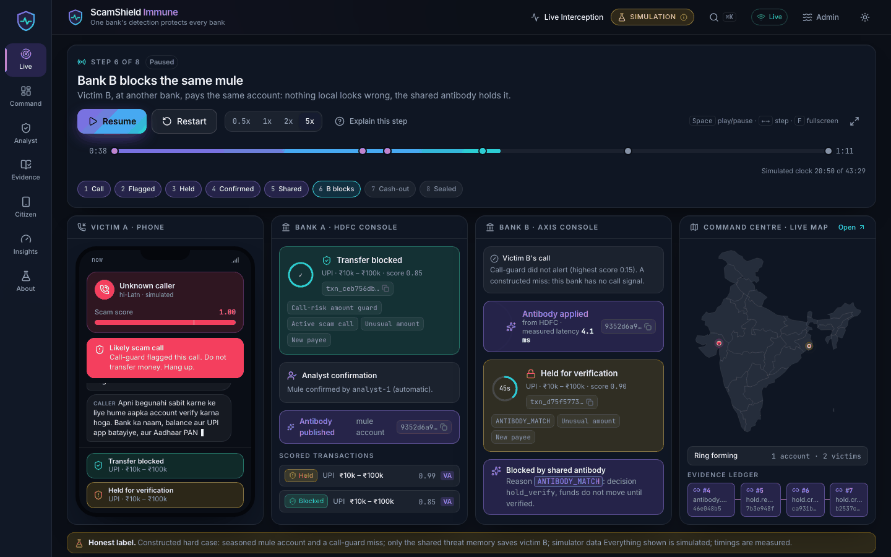
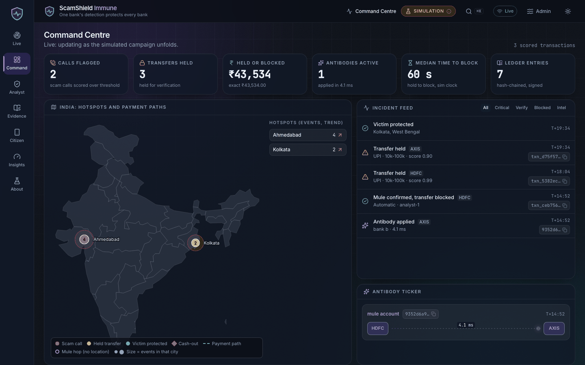
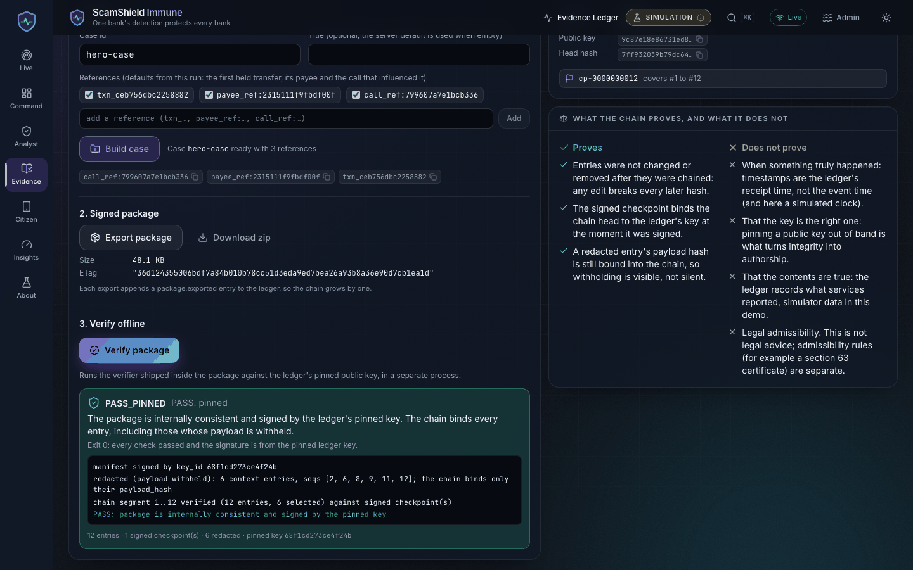
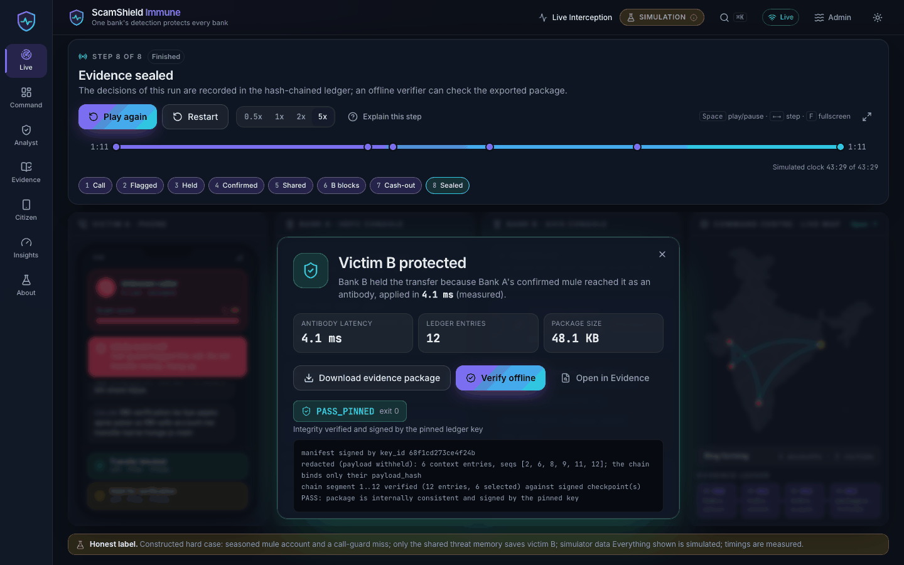
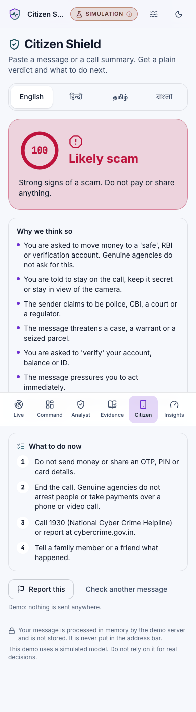
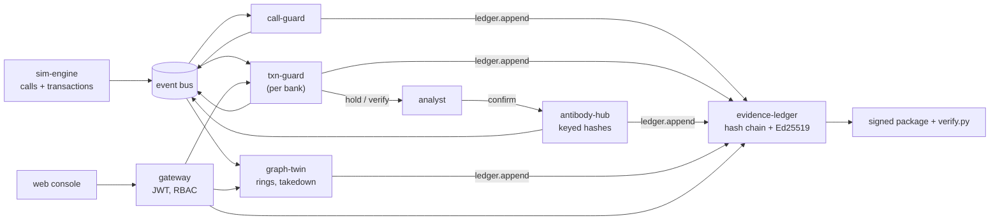

# ScamShield Immune

**One bank's detection protects every bank.** A federated scam immune system for digital-arrest
fraud and mule networks: it flags the call, holds the transfer inside the golden minutes, shares
the mule as a privacy-preserving antibody so a second victim at another bank is protected, traces
the ring, and seals the case in a tamper-evident ledger an outside expert can verify offline.

> Everything in this repository runs on simulator-generated data. No real calls, customers,
> banks or telecom feeds are involved, and no number below is a real-world performance claim.



*A short screen recording (GIF) has not been produced; the stills below are real screenshots of
the console. See [docs/demo-script.md](docs/demo-script.md) for the narrated 3-minute run.*

| Command centre | Evidence, verified |
|---|---|
|  |  |
| **Finale** | **Citizen shield (mobile, light)** |
|  |  |

More: [analyst console](docs/screenshots/analyst-1440x900-dark.png),
[insights](docs/screenshots/insights-1440x900-dark.png),
[light theme live view](docs/screenshots/player-live-1440x900-light.png).

## 60-second quickstart

Needs Python 3.11+ and Node 20+.

```bash
git clone <this repository> && cd lastproject
make install        # venv, editable installs of every package, npm ci for the console
make demo           # builds the console and serves it with the demo-server
```

Open <http://localhost:8080>, choose **Officer** on the splash, press **Play** (or Space). The
hero run takes about 71 seconds at 1x. `make help` lists every target.

This path (`make demo`) is the one that has been run and tested end to end. The multi-container
Docker stack is provided but has **not** been run: see
[What was and was not exercised](#what-was-and-was-not-exercised).

## The story in eight steps

The console's player walks one constructed case:

1. **Call begins.** Victim A (bank A) gets a scripted "digital arrest" call.
2. **Flagged.** call-guard's session score crosses 0.7 from script, legal-threat and authority cues.
3. **Held.** A's transfer to a new, young-looking payee is held for verification (txn-guard).
4. **Confirmed.** An analyst confirms the payee is a mule.
5. **Shared.** The mule becomes an antibody: a keyed hash, published to every bank.
6. **B blocks.** Victim B (bank B, another state, an off-script call nobody flagged) pays the same
   seasoned mule 90 s later; the antibody match holds it.
7. **Cash-out.** The ring graph and map show the money's route; a takedown simulator estimates harm
   reduction.
8. **Sealed.** Every decision is in a hash-chained, signed ledger; the package verifies offline.

## Architecture



Full diagrams (containers, hero sequence, PII boundaries, audit flow), failure modes, threat
model and the decisions log are in [docs/architecture.md](docs/architecture.md).

Two packagings of the same service code:

* **`make demo`**: one process (`demo-server`) composes the real call-guard, txn-guard,
  antibody-hub and evidence-ledger over an in-memory bus and serves the console. Verified path.
* **`make stack-up`**: one container per service over Redpanda, Postgres and Redis
  ([infra/docker-compose.yml](infra/docker-compose.yml)). Not run in the build environment.

## Services

| Service | Purpose | Port | Tech | Docs | Tests (passed) |
|---|---|---|---|---|---|
| [sim-engine](services/sim_engine) | seeded synthetic world, scam campaigns, hero scenario replay | 8000 | numpy, scipy, FastAPI | [README](services/sim_engine/README.md) | 51 |
| [call-guard](services/call_guard) | digital-arrest call scoring (rules + TF-IDF/logistic), `call.risk` alerts | 8000 | scikit-learn, Redis | [README](services/call_guard/README.md) | 141 |
| [txn-guard](services/txn_guard) | per-bank transaction risk: allow / step-up / hold-and-verify, antibody enforcement | 8000 | gradient boosting + policy overlays, Redis | [README](services/txn_guard/README.md) | 320 |
| [antibody-hub](services/antibody_hub) | federated threat memory: keyed hashes, TTL, revoke, outbox | 8000 | FastAPI, SQLAlchemy, Postgres | [README](services/antibody_hub/README.md) | 160 (+5 skipped) |
| [evidence-ledger](services/evidence_ledger) | append-only hash chain, signed checkpoints, evidence packages, `verify.py` | 8000 | Ed25519, SQLAlchemy, Postgres | [README](services/evidence_ledger/README.md) | 184 (+7 skipped) |
| [graph-twin](services/graph_twin) | ring detection, harm model, takedown simulation | 8000 | networkx, SQLAlchemy | [README](services/graph_twin/README.md) | 122 (+3 skipped) |
| [geo-intel](services/geo_intel) | complaint hotspots (Poisson z-score), trend, cash-out points, city level | 8000 | FastAPI, SQLAlchemy | [README](services/geo_intel/README.md) | 51 (+1 skipped) |
| [gateway](services/gateway) | JWT auth, RBAC, rate limits, reverse proxy | 8000 (published on 127.0.0.1) | FastAPI, Redis | [README](services/gateway/README.md) | 60 |
| [demo-server](services/demo_server) | single-process composition behind the console's `/api` + `/api/stream` | 8080 | FastAPI, WebSocket | [README](services/demo_server/README.md) | 182 |
| [web-console](web-console) | seven-page React console, light and dark | 5173 (dev) | React, TypeScript, Tailwind, Vite | [README](web-console/README.md) | 172 (vitest) + Playwright e2e |
| [contracts](contracts), [svckit](libs/svckit) | shared models, topics, keyed hashing; bus, idempotency, drainer, PII guard | n/a | pydantic, aiokafka | in code | 29 + 179 |
| [tests/e2e/bench](tests/e2e/bench), [tests/e2e/audit](tests/e2e/audit) | benchmark harness; hero audit-trail end to end | n/a | pytest | [bench README](tests/e2e/bench/README.md), [audit trail](docs/audit-trail.md) | 38 + 27 |

Counts are from `make test-all` (warnings as errors); skipped tests are the opt-in Postgres suites.

## How the evaluation focus is addressed

| Focus | Where it lives | Evidence |
|---|---|---|
| Counterfeit-currency detection | **Not addressed.** Dropped by decision (spec section 1) | n/a |
| Digital-arrest detection precision / recall | simulator ground truth, seed 42 | precision 100% [99.3, 100] (0 false holds in 21,736 benign), recall 82.6% [79.6, 85.3] on 680 scam transactions: [benchmark report](docs/benchmark_report.md) |
| Lead time before mass victimisation | lead-time table (10th victim as the mass-victimisation point) | 5 of 5 campaigns detected before the 10th victim; wide uncertainty with few campaigns: [report, Lead time](docs/benchmark_report.md) |
| False-positive rate | pooled and per rail, hold and step-up | held benign 0.000% (upper CI 0.018%); step-up or hold 0.097%; NEFT flagged 0.83%, IMPS 0.37%, UPI 0.016%: [report, per-rail](docs/benchmark_report.md) |
| Auditability | hash-chained ledger, signed checkpoints, offline `verify.py` | [audit trail](docs/audit-trail.md), `make verify-package`, `tests/e2e/audit` |
| Geography | command-centre map: city cells, trends, cash-out points, mule-hop arcs | `/command` ([screenshot](docs/screenshots/command-1440x900-dark.png)) |
| Citizen shield | multilingual assistant: one verdict per screen, nothing stored | `/citizen` (en, hi, ta, bn) |
| Antibody sharing | cross-bank second-victim protection, ablation | victim-transfer recall 94.5% without, 100% with, in this simulator; hero: 40 of 40 seeds held vs 1 of 40 step-up without |

A mapping to the five judging criteria is in [docs/judging-map.md](docs/judging-map.md).

## Honest limitations

* **Simulator only.** Models were trained and evaluated on data from the same generators (with
  disjoint seeds). Treat the figures as a regression and ablation harness, not real-world
  performance. Scam prevalence in the run is 3.03%, far above reality.
* **The hero is a constructed hard case**: a seasoned mule plus a deliberately off-script call. It
  shows what shared memory adds; it is not a prevalence estimate.
* **NEFT has no scam data.** NEFT thresholds are scaled by hand and tested on hand-written
  scenarios; the NEFT rows are benign-traffic results only.
* **The call signal is idealised** in the main run (alerts on every scam call, no benign call).
  The `degraded_call_signal` ablation gives an imperfect-signal figure.
* **The analyst is modelled**: antibodies are confirmed by an oracle after a fixed delay;
  antibody poisoning and false confirmations are not simulated.
* **The multi-container stack has not been run** here (no Docker daemon).
* **The demo-server is single-process**: in-memory bus, per-process signing key, no persistence.
* **No legal claim.** Packages are tamper-evident and offline-verifiable; the Section 63
  certificate is a template. Integrity is not truthfulness.
* **No load test** against real Kafka, Redis or Postgres; latency figures are in-process.
* **The gateway does not tokenise.** Identifiers are pseudonymous when they enter the platform
  (the simulator applies the tokenizer).

## What was and was not exercised

| Item | Status |
|---|---|
| `make test-all`: 13 of 13 packages pass (12 Python suites with `-W error`, 172 console unit tests) | exercised |
| `make lint`: ruff check and format on all packages, eslint and tsc on the console | exercised, clean |
| Console production build | exercised |
| `make demo`: console build, demo-server start, `/api/health`, `/`, SPA fallback, a real-time hero run (72.9 s) | exercised |
| `make verify-package` (hero package through the demo-server code path, pinned `verify.py`) | exercised, PASS |
| Benchmark: full run, seed 42; JSON equals the bundled `benchmark_summary.json` except `meta` | exercised |
| `docker compose config` with `infra/.env.example` (all profiles) | exercised |
| Dockerfile static checks (`scripts/check_dockerfiles.py`: COPY sources, non-root user, HEALTHCHECK, pinned tags) | exercised |
| `docker build` of any image; `docker compose up`; Kafka/Postgres/Redis in containers | **not exercised** |
| Prometheus `http_headers` scrape of token-gated `/metrics`; Grafana | **not exercised** |
| `make install` from an empty machine (fresh venv, network installs) | **not exercised**; the existing `.venv` and `node_modules` were used |
| Playwright e2e and screenshots in this delivery pass | not re-run here (screenshots are from the earlier console phase) |
| Demo video | **not recorded** |

## Docker stack

```bash
cp infra/.env.example infra/.env     # replace every DEMO-ONLY value (generation commands inside)
make stack-config                    # validate
make stack-up                        # core + stack profiles, builds images
make stack-hero                      # POST /scenarios/hero to sim-engine
make stack-down                      # add V=1 to also delete volumes
```

Profiles: `core` (Redpanda, topic bootstrap, Postgres, Redis), `stack` (services, gateway, demo
server), `observability` (Prometheus, Grafana). All published ports bind to 127.0.0.1; compose
refuses to start with empty secrets. Known wiring caveats are listed in the header of
[infra/docker-compose.yml](infra/docker-compose.yml) and in
[docs/architecture.md](docs/architecture.md) (section 2).

## Repository layout

```
contracts/            shared pydantic models, topic names, keyed hashing (scam_contracts)
libs/svckit/          bus, idempotency, health, drainer, PII guard, tokenizer
services/             sim_engine call_guard txn_guard antibody_hub evidence_ledger graph_twin
                      geo_intel gateway demo_server   (each: Dockerfile, pyproject.toml, tests/)
tests/e2e/            bench (benchmark harness), audit (hero audit trail end to end)
web-console/          React console (src/, e2e/ Playwright, scripts/)
infra/                docker-compose.yml, .env.example, postgres/, prometheus.yml, docker/
scripts/              check_dockerfiles.py, check_links.py, test_all.sh, verify_package.py
docs/                 architecture, benchmark report, demo script, judging map, audit trail,
                      screenshots, superpowers/ (specs and plans)
Makefile              help install test-all lint demo stack-* bench verify-package check clean
```

## Development workflow

The build followed a spec-driven, task-by-task process: design spec
([docs/superpowers/specs](docs/superpowers/specs)), implementation plan
([docs/superpowers/plans](docs/superpowers/plans)), then one task at a time with an independent
adversarial review after each, fix rounds until findings were closed, and a ledger of rulings
(summarised in the [decisions log](docs/architecture.md#9-decisions-log)). Services carry
tamper, parity, replay and fuzz-style tests in addition to unit tests where relevant; READMEs
state what is and is not guaranteed.

```bash
make test-all       # every suite, -W error; several minutes (long ones: txn_guard ~90 s,
                    # graph_twin ~55 s, demo_server ~50 s, bench ~60 s, call_guard ~25 s)
make lint           # ruff check + format --check; eslint + tsc
make check          # Dockerfile checks, markdown links, compose config
make bench          # quick benchmark -> docs/benchmark_report.quick.md
make bench-full     # full benchmark (about 3-4 minutes) -> docs/benchmark_report.md
```

## Security notes

* Secrets come from `infra/.env` (git-ignored); `infra/.env.example` holds clearly marked
  DEMO-ONLY placeholders that must be replaced. The gateway rejects JWT secrets under 32 bytes.
* Services behind the gateway trust `X-Principal-*` headers only on the internal compose network;
  the gateway does not inject a per-service secret (see architecture, section 2). Do not publish
  those ports.
* Cross-bank sharing carries keyed hashes only; the hub never holds the federation key.
* The ledger signing key is generated into a volume (0600) and should live apart from the
  database; rotated keys are listed in `LEDGER_RETIRED_PUBKEYS`.
* The demo-server's evidence verifier runs in an isolated interpreter (`-I -S`) with a timeout
  and an output cap; WebSocket origins are checked; logs are redacted.
* Containers run as uid 10001 with `no-new-privileges` and all capabilities dropped.

Per-service threat models are linked from [docs/architecture.md](docs/architecture.md#8-threat-model-summary).

## License

License: TBD. No license has been chosen; all rights reserved until one is added.

## Credits

Designed and built as a spec-driven prototype with Claude Code. Simulated data only. India
topology data for the map is bundled with the console (see `web-console/scripts`). Third-party
libraries are listed in each package's `pyproject.toml` and `web-console/package.json`.
