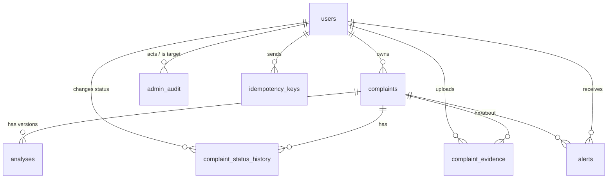
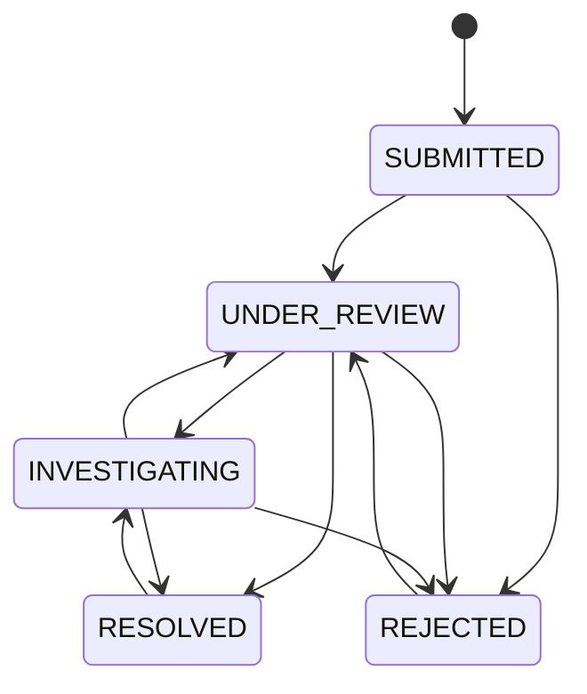

# Database design

Phase 0 deliverable, written 2026-10-15 from `services/complaints/complaints/schema.py` and
`migrations.py` at HEAD `91ebfeb`. Tables and columns below were checked against those files.
Planned structures are marked **Planned**; nothing marked planned exists yet.

## 1. Stores in this repository

The platform has two kinds of data and they are kept apart.

| Store | Owner service | Contents | Real or simulated |
|---|---|---|---|
| **Complaints database** (this document) | `services/complaints` | Users, complaints, evidence metadata, analyses, alerts, audit | **Real records** entered by signed-in users |
| Evidence files | `services/complaints` (`evidence.py` storage) | Uploaded files under random names | Real uploads |
| Simulator stores | `antibody_hub`, `evidence_ledger`, `graph_twin`, `geo_intel`, `citizen_shield`, `txn_guard` | Antibodies, hash-chained ledger, transaction graph, city hotspots, report counts, holds | **Simulated** traffic from `sim_engine` |
| Live-audio sessions | `services/live_audio` | Transcript segments and risk history, in memory only | Real microphone input, never persisted |

All stores use SQLAlchemy Core. The complaints database runs on **SQLite** for local development
(default file under the gitignored `.data/complaints/` when run through demo-server) and on
**PostgreSQL** in Docker (`COMPLAINTS_DATABASE_URL`). The simulator stores are described in
[architecture.md](architecture.md) and are not covered further here.

## 2. Entity-relationship diagram (complaints database)

All foreign keys use `ON DELETE RESTRICT`; rows are soft-deleted (`deleted_at`) rather than
removed.

## 3. Tables

### `schema_migrations`
| Column | Type | Required | Notes |
|---|---|---|---|
| version | Integer, PK | yes | Migration number |
| name | String(100) | yes | |
| applied_at | UTC datetime | yes | |

### `users`
| Column | Type | Required | Notes |
|---|---|---|---|
| id | String(36), PK | yes | UUID |
| idp_subject | String(255), unique | yes | Clerk `sub`, or `demo:`/`local:` prefixed subject |
| email | String(254) | no | From the verified token only |
| email_verified | Boolean | yes | Investigator/admin eligibility fails closed when false |
| display_name | String(100) | no | |
| display_name_set | Boolean | yes | The user chose the name (kept across sign-ins) |
| role | String(16) | yes | `CITIZEN`, `INVESTIGATOR`, `ADMIN` (CHECK) |
| role_source | String(16) | no | `bootstrap`, `allowlist`, `admin`; drives per-request re-evaluation |
| is_active | Boolean | yes | |
| allow_case_matching | Boolean | yes | Privacy setting, default true; to be honoured by future matching |
| created_at, last_login_at | UTC datetime | created_at yes | |

No password or secret column exists. Indexes: `ix_users_email`, `ix_users_role (role, is_active)`.

### `complaints`
Required: `id`, `owner_user_id`, `category`, `title`, `description`, `reported_at` (set by the
server), `status`, `created_at`, `updated_at`. **Everything else is optional and stored as NULL
when absent.**

| Group | Columns |
|---|---|
| Core | category (9 values: DIGITAL_ARREST, UPI_FRAUD, PHISHING, OTP_SCAM, BANK_FRAUD, INVESTMENT_SCAM, JOB_SCAM, SOCIAL_MEDIA_FRAUD, OTHER), title (200), description (text), status (SUBMITTED, UNDER_REVIEW, INVESTIGATING, RESOLVED, REJECTED) |
| Time | incident_at, reported_at, created_at, updated_at, deleted_at |
| Money | amount (Money/decimal), currency (3), payment_method (UPI, CARD, NETBANKING, WALLET, CASH, BANK_TRANSFER, OTHER), upi_id, utr_reference |
| Bank (migration 3) | bank_name (100), bank_account (6-18 digits), ifsc (`^[A-Z]{4}0[A-Z0-9]{6}$`) |
| Suspect | suspect_phone, suspect_email, suspicious_url, social_platform, social_account |
| Location | location_text, city, state, latitude (-90..90), longitude (-180..180) |

Indexes: `ix_complaints_owner (owner_user_id, created_at)`, `ix_complaints_status`,
`ix_complaints_category`, `ix_complaints_created`, `ix_complaints_city`,
`ix_complaints_bank_account`.

Status transitions (enforced in `store.py`):

### `complaint_status_history`
id, complaint_id, from_status, to_status, actor_user_id, note (500), created_at. Index
`ix_history_complaint (complaint_id, created_at)`.

### `complaint_evidence`
id, complaint_id, uploader_user_id, original_filename (120, sanitised), mime_type (from content
sniffing), size_bytes, sha256, storage_key (64, unique, random), status (`stored`, `rejected`,
`deleted`), created_at, deleted_at. Index `ix_evidence_complaint (complaint_id, status)`.

Accepted types (by magic bytes, extension must agree): PNG, JPEG, WebP, PDF, MP3, WAV, OGG/Opus,
M4A. Default limits: images and PDFs 10 MiB, audio 25 MiB, 10 files per complaint
(`COMPLAINTS_MAX_*`).

### `analyses`
id, complaint_id, version (unique per complaint), created_at, pipeline_version, capabilities
(JSON), risk_score (0-100), risk_level (`LOW`, `MEDIUM`, `HIGH`, `CRITICAL`, or NULL), classification,
confidence, indicators (JSON), explanation, recommended_actions (JSON), limitations (JSON), status
(`COMPLETED`, `PARTIAL`, `UNAVAILABLE`, `INSUFFICIENT_INPUT`), detail (JSON: provenance, category
model output, URL and entity checks, LLM explanation and its status). Index `ix_analysis_level`.

### `alerts`
id, user_id, complaint_id, kind, message (300), risk_level (migration 8; used to avoid repeating a
risk alert for the same complaint and level), created_at, read_at. Index
`ix_alerts_user (user_id, read_at, created_at)`.

### `admin_audit`
id, actor_user_id, action (40), target_user_id, before (JSON), after (JSON), created_at. Indexes
`ix_audit_created`, `ix_audit_target (target_user_id, action)`. Actions written today include
`admin_bootstrap`, `investigator_entry`, `investigator_access_lapsed/_restored`,
`admin_access_lapsed/_restored`, `role_change`, `activate`, `deactivate`, `profile_update` (without
the name), `complaint_delete`, `evidence_delete`. **Evidence downloads are not audited.**

### `idempotency_keys`
id, user_id, key_hash, request_hash, complaint_id, created_at. Unique `(user_id, key_hash)`.
Makes a repeated complaint submission with the same `Idempotency-Key` return the first result.

## 4. Ownership rules (enforced in the store and API)

| Rule | Mechanism |
|---|---|
| A citizen sees only their own complaints, evidence, analyses and alerts | Queries are scoped by `owner_user_id`; a foreign id returns **404**, never 403, so existence is not revealed |
| Investigators and admins see all complaints | `staff` scope in the store; status changes require `INVESTIGATOR` or `ADMIN` |
| Evidence upload | Complaint owner (citizen) only; refused on closed complaints |
| Evidence delete | Owner while the complaint is `SUBMITTED`, or an admin; investigators get 403 |
| Roles | Read only from `users`; per-request effective role re-checks the allowlist/bootstrap lists |

## 5. Migration strategy

Versioned, ordered, idempotent steps in `services/complaints/complaints/migrations.py`, recorded in
`schema_migrations`, run at service start-up and by `python -m complaints.migrate`. On Postgres the
run holds an advisory lock so replicas starting together serialise.

| # | Name | Change |
|---|---|---|
| 1 | baseline | Original tables |
| 2 | analyses_detail_column | `analyses.detail` JSON (replaced an earlier ad-hoc ALTER) |
| 3 | complaint_bank_details | bank_name, bank_account, ifsc + index |
| 4 | user_profile_privacy | allow_case_matching, display_name_set |
| 5 | evidence_deleted_status | `deleted` evidence status (SQLite table rebuild / Postgres constraint swap) |
| 6 | analyses_critical_level | `CRITICAL` allowed in the risk-level CHECK; backfill from `detail` |
| 7 | analyses_insufficient_input | `INSUFFICIENT_INPUT` status; column widened on Postgres |
| 8 | alerts_risk_level | `alerts.risk_level` for de-duplication |

Migrations 6-8 are in the unpushed Phase B commits. Every step is re-checked at start-up (not only
pending ones), so a database missing a column is repaired. Alembic was considered and not adopted;
see [TECHNOLOGY_DECISIONS.md](TECHNOLOGY_DECISIONS.md).

## 6. Data retention and privacy

| Topic | Today | Status |
|---|---|---|
| Passwords | Never stored (identity provider or one-time codes) | Implemented |
| Raw live audio | Never stored; chunk held in memory while transcribed | Implemented |
| Live transcripts | Server memory only, deleted on Stop or after 10 idle minutes | Implemented |
| Complaint text and identifiers | Stored in plain columns (needed for review and matching) | Implemented; **not encrypted at column level** |
| Evidence files | Local disk, random names, outside the web root | Implemented; **not encrypted, not malware-scanned** |
| Deletion | Soft delete (`deleted_at`); evidence file removed on evidence delete | Implemented |
| Retention schedule | None | **Not implemented** |
| Logs | Request logs carry hashed user ids, no bodies; transcripts and tokens not logged | Implemented (tests) |

## 7. Planned structures (not implemented)

| Structure | Purpose | Phase |
|---|---|---|
| `investigation_notes` | Investigator notes separate from status history | 12 |
| `complaint_entities` + `complaint_links` | Normalised identifiers per complaint; links typed `observed` / `inferred` / `confirmed` with evidence and reviewer | 9 |
| Vector collection (Qdrant) | Privacy-filtered embeddings keyed by complaint/analysis id, minimal metadata | 8 |
| Geographic aggregation | SQL grid over `latitude/longitude` first; PostGIS geometry column optional | 10 |
| Report exports | Generated complaint/case reports with access control | 12 |
| Evidence-access audit | Audit rows for downloads | 14 |
| Retention job | Scheduled deletion per a documented policy | 14 |
