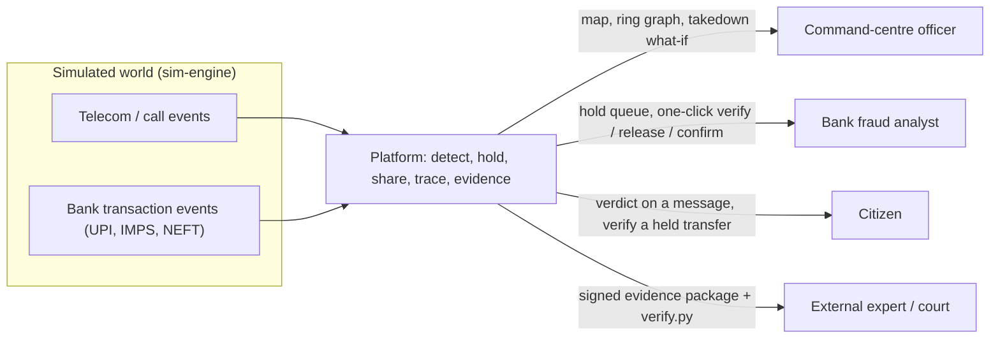
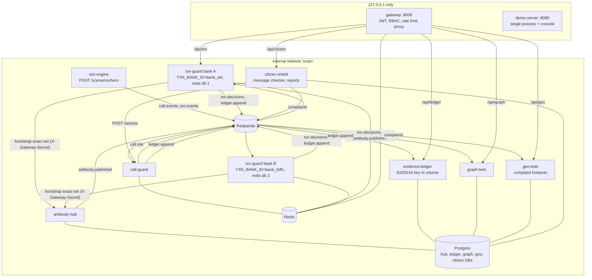
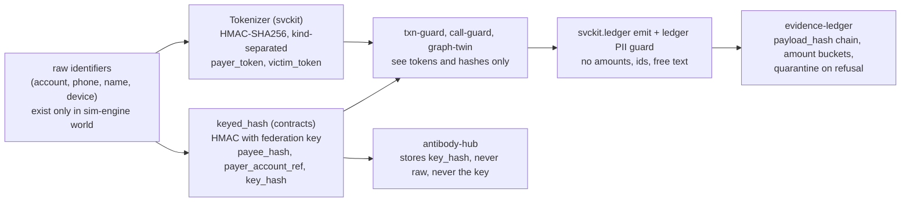
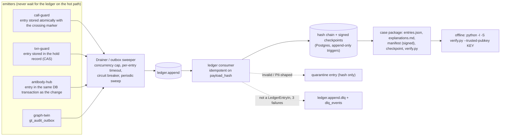

# Architecture

This page describes the platform as built. Everything runs on simulator-generated data. Two
packagings of the same service code exist:

* **Single-process demo** (`make demo`): the demo-server composes the real service code over an
  in-memory bus and serves the console. This is the path that was run and tested end to end.
* **Multi-container stack** (`infra/docker-compose.yml`): one container per service over
  Redpanda, Postgres and Redis. It has been validated with `docker compose config` only; it has
  not been built or started in the environment this repository was written in (no Docker daemon).

Diagrams are Mermaid and render on GitHub.

## 1. System context



Real telecom and bank integrations are out of scope; the simulator is the only data source.
Counterfeit-currency detection was dropped by decision (spec section 1).

## 2. Containers (compose stack)



Notes on the wiring, all from `infra/docker-compose.yml`:

* The gateway forwards `X-Principal-Role` / `X-Principal-Sub` but injects no per-service secret.
  Services behind it therefore run with `TRUST_GATEWAY_HEADERS=1` and are reachable only on the
  internal network. The hub is the exception: it is not routed by the gateway, and the txn-guards
  present `HUB_GATEWAY_SECRET` as `X-Gateway-Secret`.
* `/api/geo` is served by the standalone `geo-intel` service in the stack (`GATEWAY_UPSTREAM_GEO`);
  it is fed by `complaints` events, while the demo-server still computes its own geographic view
  in process from the simulator's points.
* Each txn-guard instance consumes `txn.events` and `call.risk` with its own group
  (`txn-guard-<TXN_BANK_ID>`) and drops transactions whose `bank_id` is another bank's (acked and
  counted in `txn_guard_foreign_bank_events_total`, never scored or recorded). A bank with no
  instance is therefore not scored by anyone. Antibody consumption uses one group per bank
  (`txn-guard-antibody-<bank>`), so each bank sees every antibody.
* Topics are created by the one-shot `topics-init` job: `txn.events`, `call.events`, `call.risk`,
  `txn.decisions`, `antibody.published`, `ledger.append`, `complaints`, each with a `.dlq`.
* Schemas are created by the services themselves on start (`*_CREATE_SCHEMA=1`, serialised by a
  Postgres advisory lock); the `migrate` modules exist for a stricter deploy.
* Neo4j is not used. graph-twin keeps the graph in memory (networkx) and persists nodes, edges,
  rings and its audit outbox through SQLAlchemy (SQLite in tests, Postgres in the stack).

## 3. The hero scenario

```mermaid
sequenceDiagram
  autonumber
  participant Sim as sim-engine
  participant CG as call-guard
  participant TA as txn-guard (bank A)
  participant An as analyst
  participant Hub as antibody-hub
  participant TB as txn-guard (bank B)
  participant Led as evidence-ledger
  participant Off as officer / verify.py
  Sim->>CG: call.events (victim A, scripted digital-arrest call)
  CG-->>TA: call.risk (score crosses 0.7)
  CG-->>Led: callrisk.alert (background outbox)
  Sim->>TA: txn.events (A pays mule M)
  TA-->>An: hold_verify (reason codes incl. ACTIVE_SCAM_CALL)
  TA-->>Led: hold.created
  An->>TA: resolve: confirm_block
  An->>Hub: antibody for M (keyed hash, TTL 14 d)
  Hub-->>TB: antibody.published
  Hub-->>Led: antibody.created (same DB transaction)
  Sim->>TB: txn.events (victim B pays M 90 s later, no flagged call)
  TB-->>TB: ANTIBODY_MATCH floors score to hold_verify
  TB-->>Led: hold.created (B)
  Sim->>TA: cash-out of the ring (graph-twin sees the sweep)
  Off->>Led: POST /cases, GET /packages/{case}
  Off->>Off: python -I -S verify.py --trusted-pubkey KEY
```

Console step keys, in order: `call_begins`, `call_flagged`, `transfer_held`, `analyst_confirms`,
`antibody_shared`, `bank_b_blocks`, `cash_out`, `evidence_sealed`. The hero is a constructed hard
case: B's call is off-template (not flagged), the mule is seasoned (68 to 398 days), so only the
shared memory saves B. In the benchmark's 40 hero seeds the model alone allowed B's first transfer
39 times and step-up'd it once; with the antibody all 40 were held for verification.

## 4. PII boundaries



| Value | Form on the wire | Where it is produced | Who can see it |
|---|---|---|---|
| payer / victim identity | `tok_<hmac>` token | `svckit.Tokenizer`, applied by the simulator (the stand-in for the bank/telco edge) | all services; not reversible without the secret |
| payee account | `payee_hash` (keyed hash, kind `payee`) | the bank, with the federation key | txn-guard, hub, graph-twin; the hub never holds the key |
| paying account (for graph linking) | `payer_account_ref`, same function and key as `payee_hash` | the paying bank | graph-twin |
| antibody | `key_hash` (64 hex) | the confirming bank | every bank (the intended shared datum) |
| amounts in the ledger | bucket (`<1k` ... `>=1m`) | emitter | ledger, packages |
| ledger joins | `txn_<16 hex>`, `payee_ref:<16 hex>`, `call_ref:<16 hex>` | emitters | ledger, packages |
| ring graph in the console | 12-hex prefixes | graph-twin views | analysts, officers |

The specification places tokenisation at the gateway; in the implementation the gateway does not
tokenise (it authenticates, authorises and proxies). Identifiers are already pseudonymous when
they reach it. See `docs/audit-trail.md` for what is recorded, hashed and never recorded.

## 5. Audit trail flow



Chain order is receipt order, not event order. Integrity is not truthfulness: the ledger records
what services told it. See `services/evidence_ledger/README.md` (Threat model, Known limits).

## 6. Failure modes

Distilled from the service READMEs. "Fail-open" means the protection is weaker, not that a
payment is blocked.

| Dependency down | Service | Behaviour | Source |
|---|---|---|---|
| evidence-ledger / `ledger.append` | call-guard | alert is published first; audit entries stay in the session store and are retried by a sweeper with a breaker; only a double store failure plus process death loses one (counted, ERROR-logged) | call_guard README, ledger entry section |
| evidence-ledger / `ledger.append` | txn-guard | decision path never waits; entries sit in the hold record (outbox) and drain at-least-once | txn_guard README, Audit |
| evidence-ledger | antibody-hub | audit entry is in the same DB transaction as the change; delivery is via the hub outbox | antibody_hub README |
| bus (Kafka) | txn-guard | consume retries, then DLQ; a hold-store outage publishes and records nothing; replays republish the identical first decision | txn_guard README, Hold-and-verify |
| bus | antibody-hub | outbox rows retry each drain; parked after 10 failures and 900 s; `POST /admin/outbox/unpark` re-queues | antibody_hub README, Operations |
| bus | evidence-ledger | consumer is restarted on connection failure; nothing is dropped | evidence_ledger README, Consumer |
| Redis | gateway | rate limiter fails open (0.25 s connect timeout, 0.5 s limiter timeout) | gateway/main.py |
| Redis | txn-guard | history, holds, pending and idempotency live there; without it transactions are not decided (retry then DLQ). Required (`REDIS_URL`) | txn_guard README |
| Redis | call-guard | session state is in Redis when `REDIS_URL` is set; losing the session store is one of the two ways an audit entry can be lost (see first row) | call_guard README |
| antibody-hub | txn-guard | startup bootstrap bounded (15 s); on failure WARNING, `antibody_bootstrap_failed=1`, runs on events only, re-bootstraps every 900 s; unknown antibodies are not enforced (fail-open) | txn_guard README, Cross-bank antibodies |
| model artifact missing / tampered | call-guard, txn-guard | SHA-256 pin, version and smoke test; otherwise rules-only fallback, `/readyz` shows `fallback_mode=true` | txn_guard README, Fallback |
| analyst does not resolve a hold | txn-guard | hold stays open, flagged overdue; never auto-released or auto-blocked | txn_guard README |
| graph-twin restart | graph-twin | graph rebuilt from nodes and edges; rings reloaded; seeds marked dirty for the first pass | graph_twin README |
| Postgres | hub, ledger, graph-twin | no in-memory fallback; writes fail and consumers retry then dead-letter. Not a documented degradation path in the service READMEs | n/a |

## 7. Deployment notes

Partitioning and ordering (from `contracts/scam_contracts/topics.py`):

| Topic | Key | Why |
|---|---|---|
| `txn.events` | `payer_token` | history, velocity and the call-risk window need per-payer order |
| `call.events`, `call.risk` | `victim_token` (same identity domain as `payer_token`) | a call's risk must meet that payer's transactions in order |
| `txn.decisions` | `txn_id` | consumers dedupe on `(txn_id, decision_seq)` and act on the highest |
| `antibody.published` | `key_hash` | per-key order: a revoke must not overtake its create |
| `ledger.append` | none required | the ledger is idempotent on the full entry; order is receipt order |

Scaling, as designed (not load-tested here): txn-guard and call-guard are stateless apart from
Redis and scale by consumer-group partitions; the hub and ledger scale as replicas over one
Postgres (schema creation serialised by advisory lock); graph-twin is a single replica that owns
the graph (no sharding, documented limitation). Run hub/ledger/graph with `*_CREATE_SCHEMA=0`
after `python -m <service>.migrate` in a real deploy. The ledger signing key belongs on a host
separate from the database; rotate with `LEDGER_RETIRED_PUBKEYS`.

## 8. Threat model summary

| Area | Main assumption / mitigation | Where it is written down |
|---|---|---|
| Edge auth | HS256 JWT, 32-byte secret minimum, RBAC per route prefix, per-role rate limit, body and response caps, bad-path rejection | `services/gateway/gateway/main.py` docstring and code |
| Internal trust | services trust gateway headers only on the internal network (or with a shared secret); hub requires `X-Gateway-Secret` | each service's `principal()` in `api.py`; `infra/docker-compose.yml` |
| Cross-bank sharing | keyed hashes only; hub never holds the key; role `bank` bound to its own `X-Principal-Bank`; any analyst may revoke (audited) | `services/antibody_hub/README.md` (Threat model, Cross-bank behaviour) |
| Antibody poisoning / wrongful block | 14-day TTL, revoke tombstones, protected (allowlisted) hashes, established-payee downgrade to step-up; poisoning is not simulated | `services/antibody_hub/README.md`, `services/txn_guard/README.md` |
| Ledger tampering | hash chain, signed checkpoints, signed manifest, pinned-key verification; a DB superuser can still edit rows (made detectable, not prevented) | `services/evidence_ledger/README.md` (Immutability, Threat model) |
| Ledger content | PII guard, quarantine entries, 4 KiB payload cap | `services/evidence_ledger/README.md` (PII guard) |
| Graph poisoning | gates reduce accidental rings, not deliberate injection; producers must be authenticated | `services/graph_twin/README.md` (Threat model) |
| Demo server | origin-checked WebSocket, capped bodies, log redaction, isolated `-I -S` verifier with timeout and output cap | `services/demo_server/README.md` |
| Citizen assistant | in the demo-server: scored in memory by the real call-guard scorer; in the stack the standalone `citizen-shield` service calls call-guard over HTTP and keeps only keyed-hash anonymous reports; not stored, logged or echoed; static advice texts in en/hi/ta/bn; no LLM | `services/demo_server/README.md` (Citizen assistant) |

## 9. Decisions log

Rulings made during the build (from the SDD ledger). Each has a stated cost-if-wrong in the ledger.

| Decision | Choice | Reason |
|---|---|---|
| Counterfeit-currency detection | dropped by decision | out of scope in the spec |
| Tabular model | scikit-learn `HistGradientBoostingClassifier` + isotonic calibration instead of LightGBM | avoids a native libomp dependency on macOS and in slim images; same `Scorer` interface |
| Graph store | in-memory networkx + SQLAlchemy persistence instead of Neo4j | no Docker daemon to run or test Neo4j; same persistence pattern as hub and ledger; `GraphStore` is the swap surface |
| Held-benign rate | accepted 0.103% on first calibration (point estimate marginally above the 0.1% target, CI straddles it) to close a test-then-escalate mule bypass | holds are verify steps, not blocks; later NEFT rail scaling brought the pooled held-benign rate down to 0.024% on four held-out seeds |
| NEFT | rail-scaled thresholds (x5, z >= 6, model damper with call-risk exemptions) after benign NEFT holds measured 1.24% | the simulator has no NEFT scams: NEFT detection is covered by hand-written scenarios only |
| Ledger quarantine | refused entries become durable hash-only quarantine entries; unparseable messages go to `dlq_events` (sha256 only) | the chain records that something happened without storing its content; the ledger never drops |
| Ledger on the hot path | no await on the ledger in call-guard or txn-guard; outbox + breaker + sweeper | an audit outage must not delay a fraud action |
| Frontend first | console and demo-server were built before graph-twin review (user ruling, 2026-10-10) | the demo path needed a backend contract early |
| Demo packaging | one process over an in-memory bus (`demo-server`) is the verified path; the compose stack is the production-shaped packaging | a Docker daemon was not available to run the stack |
| Python version | developed on 3.13, packages target `>=3.11`, images use `python:3.11-slim` | plan said 3.11 |
| Gateway-to-service trust | `TRUST_GATEWAY_HEADERS=1` on the internal network instead of per-service shared secrets (the gateway does not inject one) | smallest change that works with the gateway as built; documented in the compose file |
| Push policy | initially no push until the user confirms; later the user authorised per-task pushes and, on 2026-10-12, a fast-forward of `main` (`main` and `build/implementation` are the same commit) | user ruling |
